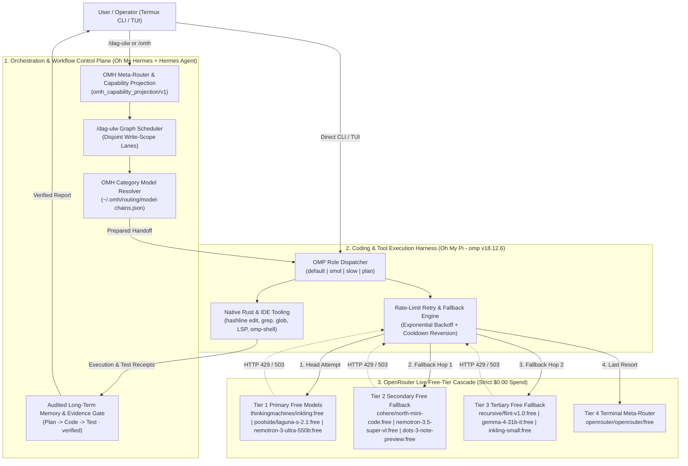
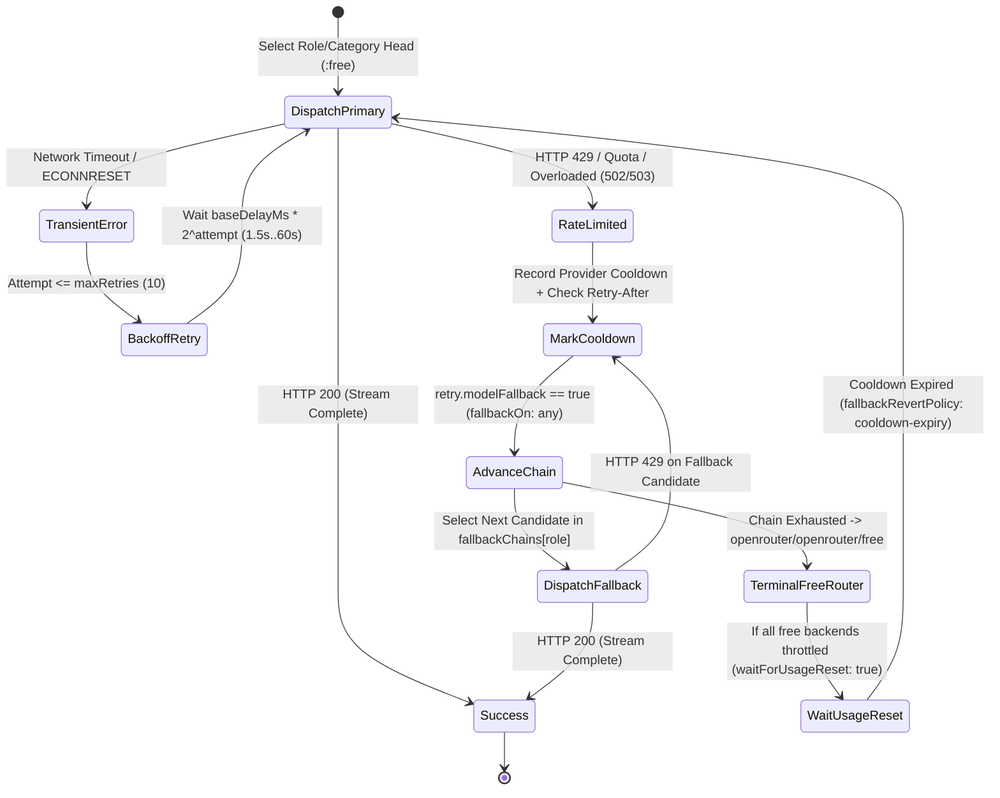

# Technical Architecture & Implementation Specification
## Oh My Pi (`omp`) + Oh My Hermes (`omh`) with OpenRouter Free-Tier Cascade & Rate-Limit Recovery

| Specification Metadata | Details |
| :--- | :--- |
| **Spec ID** | `SPEC-OMH-OMP-OR-2026-001` |
| **Related BRD** | [BRD.md](./BRD.md) (`BRD-OMH-OMP-OR-2026-001`) |
| **Version** | `1.1.0` (Verified Live against OpenRouter `/api/v1/models`) |
| **Status** | Live & Smoke-Tested (`OMP_FREE_ROUTER_READY`) |

---

## 1. System Architecture Overview

The architecture separates the **Cognitive Orchestration & Workflow Layer** (**Hermes Agent + Oh My Hermes (`omh`)**) from the **Terminal Execution & Code Manipulation Harness** (**Oh My Pi (`omp`)**), while routing 100% of LLM inference requests through **OpenRouter's Live Free-Tier Model Pool** with multi-stage rate-limit retry and automatic model failover.

---

## 2. Live Verified OpenRouter Free-Tier Catalog (`tools=true`, `reasoning=true`)

Queried directly from `https://openrouter.ai/api/v1/models` and verified against `omp`'s catalog, the following **14 live `:free` tool-calling models** form our active zero-cost pool:

| Model Selector (`omp` / `omh`) | Vendor Family | Context Window | Supported Thinking Levels | Primary Agentic Role |
| :--- | :--- | :--- | :--- | :--- |
| `openrouter/thinkingmachines/inkling:free` | Thinking Machines | 1,048,576 | `minimal,low,medium,high,max` | **OMP `default` & `plan`** / OMH `ultrabrain` & `deep` |
| `openrouter/thinkingmachines/inkling-small:free` | Thinking Machines | 1,048,576 | `minimal,low,medium,high,max` | **OMP `smol`** / OMH `unspecified-low` |
| `openrouter/nvidia/nemotron-3-ultra-550b-a55b:free` | NVIDIA | 1,000,000 | `medium,high` | **OMP `slow`** / OMH `architect` |
| `openrouter/poolside/laguna-s-2.1:free` | Poolside | 262,144 | `minimal,low,medium,high` | OMH `capable` & `unspecified-high` / Code specialist |
| `openrouter/poolside/laguna-xs-2.1:free` | Poolside | 262,144 | `minimal,low,medium,high` | Fast code subagent fallback |
| `openrouter/cohere/north-mini-code:free` | Cohere | 256,000 | `minimal,low,medium,high` | Code generation & edit fallback |
| `openrouter/nvidia/nemotron-3.5-super-vl:free` | NVIDIA | 1,000,000 | `minimal,low,medium,high` | OMH `visual-engineering` & multimodal reasoning |
| `openrouter/nvidia/nemotron-3.5-lightning:free` | NVIDIA | 1,000,000 | `minimal,low,medium,high` | OMH `quick` & low-latency subagents |
| `openrouter/dots-studio/dots-3-note-preview:free` | Dots Studio | 512,000 | `minimal,low,medium,high` | OMH `writing` & documentation synthesis |
| `openrouter/recursive/flint-v1.0:free` | Recursive | 262,144 | `minimal,low,medium,high` | Multi-step code & reasoning fallback |
| `openrouter/xingchen-agi/xing4.0-29b-a4b:free` | XingChen | 262,144 | `minimal,low,medium,high` | General reasoning fallback |
| `openrouter/google/gemma-4-31b-it:free` | Google Gemma | 262,144 | `minimal,low,medium,high` | OMH `simple-work` & general fallback |
| `openrouter/google/gemma-4-26b-a4b-it:free` | Google Gemma | 262,144 | `minimal,low,medium,high` | Fast MoE fallback |
| `openrouter/openrouter/free` | OpenRouter Meta | 200,000 | `minimal,low,medium,high` | **Terminal Catch-All Free Router** |

---

## 3. Rate-Limit Retry & Fallback State Machine Specification

---

## 4. Active Configuration Files

- **OMP Global Config:** [`~/.omp/agent/config.yml`](file:///data/data/com.termux/files/home/.omp/agent/config.yml)
- **OMP Credential Environment:** [`~/.omp/env`](file:///data/data/com.termux/files/home/.omp/env)
- **OMH Category Model Chains:** [`~/.omh/routing/model-chains.json`](file:///data/data/com.termux/files/home/.omh/routing/model-chains.json)
- **Hermes Agent Config:** [`~/.hermes/config.yaml`](file:///data/data/com.termux/files/home/.hermes/config.yaml)
